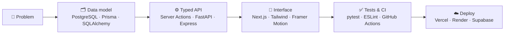

<!--
═══════════════════════════════════════════════════════════════
  COMO EDITAR ESTE README (comentários não aparecem no perfil)

  • Links dos projetos  → bloco "LINKS" no final do arquivo.
                          Quando a Trilha subir na Vercel, troque
                          só a linha [trilha-demo]: e pronto.
  • Imagens / arte      → pasta /assets. Para trocar uma imagem,
                          substitua o arquivo mantendo o mesmo nome.
  • Badges              → geradas em https://shields.io
═══════════════════════════════════════════════════════════════
-->

<h1 align="center">Bernardo Guimarães</h1>

  <b>Full-stack developer — Next.js · TypeScript · Node.js · Python</b> 
  CS student at Atitus Educação · Sarandi, Rio Grande do Sul, Brazil · Open to remote internship &amp; junior roles

  
  
  
  

---

## About

I build web products end to end — Next.js interfaces, typed APIs, relational data models — with two apps in production and real client systems built from scratch. Lately I've been wiring machine learning and LLMs **into** the product rather than bolting them on top.

- 🛠️ Currently building **[Trilha][trilha-repo]** — learning diagnostics for Brazilian elementary schools: scikit-learn risk models, BNCC skill tracking, and LLM-generated practice, with a voice interface for teachers.
- 🚀 Shipped **[EloPet][elopet-demo]** — a micro-SaaS with OAuth2, Stripe payments, and a Prisma/PostgreSQL data layer.
- 🧩 Comfortable owning a feature from schema to deploy: validation, auth, tests, CI, and the button the user actually clicks.
- 🎓 AWS Academy Graduate — Cloud Foundations.

---

## How I ship

Schema first, types end to end, and nothing reaches the UI that hasn't been validated at the edge (Zod / Pydantic).

---

## Featured projects

| Project | What it is | Stack | Live |
|---|---|---|---|
| **[Trilha][trilha-repo]** | Learning diagnostics with ML + LLMs: per-skill tracking against the BNCC curriculum, early-warning signals for teachers, AI-generated practice and voice Q&A about the class | `Next.js 16` `React 19` `FastAPI` `SQLAlchemy` `scikit-learn` `Groq` `Supabase` | *soon* |
| **[EloPet][elopet-repo]** | Micro-SaaS for pet rescue profiles and online donations. TypeScript end to end with typed Server Actions, removing intermediate REST endpoints | `Next.js (App Router)` `TypeScript` `OAuth2` `Stripe` `PostgreSQL` `Prisma` `Zod` | [live][elopet-demo] |
| **[HolyGames][holygames-repo]** | Game discovery platform: React Server Components for optimized rendering and indexing, skeleton loading states, dynamic SEO via Open Graph and per-route meta tags | `Next.js 15` `React Server Components` `Tailwind CSS` `Framer Motion` | [live][holygames-demo] |
| **[GitHub Profile Explorer][searchdevs-repo]** | Technical challenge (Petize): infinite scroll with Intersection Observer, PT-BR/EN-US i18n, dynamic metadata per profile, CacheProvider against hydration mismatch in SSR | `Next.js` `TypeScript` `generateMetadata` `SSR` | [live][searchdevs-demo] |

---

## Stack

**Languages**

**Front-end**

**Back-end &amp; data**

**AI &amp; data**

**Tooling**

---

## Experience

**Revista Spelho** — Technical Support &amp; Media Intern · *Mar 2025 – Feb 2026*
Automated the billing control spreadsheets, removing manual payment-status updates and cutting operational errors. Shipped front-end improvements to the company site and handled client support and digital channels.

**Secretaria Escola Sarandi** — Media Assistant · *Jan 2024 – Feb 2025*
Built a database-backed web system to manage the school office's records, replacing manual processes, plus an internal management module for the student union.

---

## Education &amp; certifications

**BSc in Computer Science** — Atitus Educação, Passo Fundo/RS · 3rd semester, expected Dec 2028

**[AWS Academy Graduate — Cloud Foundations][aws-cert]** — Amazon Web Services, Jun 2026

**Languages** — Portuguese (native) · Spanish (advanced) · English (intermediate)

---

## `$ ./render --me`

  

  

---

  <i>Open to remote internships and junior developer roles — in Portuguese, Spanish or English.</i> 
  <a href="mailto:bernardocfguima@gmail.com">bernardocfguima@gmail.com</a> ·
  <a href="https://www.linkedin.com/in/bernardoguimaraesdev">LinkedIn</a> ·
  <a href="https://bernardoportfolio.vercel.app">Portfolio</a>

<!-- ══════════════════ LINKS — edite só aqui ══════════════════ -->
<!-- TRILHA_DEMO: quando subir na Vercel, cole a URL em [trilha-demo]
     e troque o "*soon*" da tabela por [live][trilha-demo] -->

[trilha-repo]: https://github.com/Bernardocfguimaraes/trilha
[trilha-demo]: https://github.com/Bernardocfguimaraes/trilha
[elopet-repo]: https://github.com/Bernardocfguimaraes/EloPet
[elopet-demo]: https://elo-pet.vercel.app
[holygames-repo]: https://github.com/Bernardocfguimaraes/holygames
[holygames-demo]: https://holygames.vercel.app
[searchdevs-repo]: https://github.com/Bernardocfguimaraes/SearchDevs-Petize
[searchdevs-demo]: https://search-devs-kappa.vercel.app
[aws-cert]: https://www.credly.com/go/MbXhNnrD
