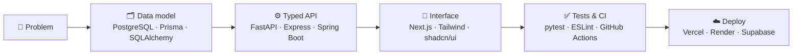

<!--
═══════════════════════════════════════════════════════════════
  COMO EDITAR ESTE README (comentários não aparecem no perfil)

  • Links dos projetos  → bloco "LINKS" no final do arquivo.
                          Quando a Trilha subir na Vercel, troque
                          só a linha [trilha-demo]: e pronto.
  • Imagens / arte      → pasta /assets. Para trocar uma imagem,
                          substitua o arquivo mantendo o mesmo nome.
  • Badges              → geradas em https://shields.io
  • Heatmap             → /assets/contributions.svg é um SNAPSHOT
                          estático. Regere e substitua quando quiser.
═══════════════════════════════════════════════════════════════
-->

<h1 align="center">Bernardo Guimarães</h1>

  <b>Full-stack developer — TypeScript on the front, Python and Node on the back.</b> 
  CS student at Atitus Educação · Rio Grande do Sul, Brazil · Open to remote internship &amp; junior roles

  
  
  
  

---

## About

I build web products end to end — Next.js interfaces, typed APIs, relational data models — and lately I've been wiring machine learning and LLMs **into** the product rather than bolting them on top.

- 🛠️ Currently building **[Trilha][trilha-repo]** — learning diagnostics for Brazilian elementary schools: scikit-learn risk models, BNCC skill tracking, and LLM-generated practice, with a voice interface for teachers.
- 🚀 Shipped **[EloPet][elopet-demo]** — a full-stack micro-SaaS with OAuth2, Stripe payments, and a Prisma/PostgreSQL data layer.
- 🧩 Comfortable owning a feature from schema to deploy: validation, auth, tests, CI, and the button the user actually clicks.
- 📍 Based in Sarandi, RS — looking for **remote** opportunities.

<code>$ cat bernardo.png | ascii --render</code>

 

  

  

---

## How I ship

Schema first, types everywhere, and nothing reaches the UI that hasn't been validated at the edge (Zod / Pydantic).

---

## Featured projects

| Project | What it is | Stack | Live |
|---|---|---|---|
| **[Trilha][trilha-repo]** | Learning-diagnostic platform: per-skill student tracking, early-warning signals for teachers, AI-generated exercises and voice Q&A | Next.js 16 · React 19 · FastAPI · SQLAlchemy · scikit-learn · Groq · Supabase | *soon* |
| **[EloPet][elopet-repo]** | Micro-SaaS for pet rescue profiles and donations — OAuth2 login, image uploads, real payments | Next.js · TypeScript · Prisma · PostgreSQL · Auth.js · Zod · Stripe | [demo][elopet-demo] |
| **[HolyGames][holygames-repo]** | Game discovery platform with a cyber-minimalist UI, server actions, and per-game social metadata | Next.js 15 · React Server Components · Tailwind · Framer Motion | [demo][holygames-demo] |
| **[SearchDevs][searchdevs-repo]** | GitHub user search built as a company technical challenge | React · JavaScript · REST API | [demo][searchdevs-demo] |

---

## Stack

**Languages**

**Front-end**

**Back-end &amp; data**

**AI &amp; data science**

**Tooling**

---

<b>Beyond the featured four</b> — coursework, experiments and older builds

 

- **Java / OOP** — [Rest-API-SpringBoot](https://github.com/Bernardocfguimaraes/Rest-API-SpringBoot), [Biblioteca-Java](https://github.com/Bernardocfguimaraes/Biblioteca-Java), [Zoo-Digital](https://github.com/Bernardocfguimaraes/Zoo-Digital)
- **Node APIs** — [CRUD-EXPRESS](https://github.com/Bernardocfguimaraes/CRUD-EXPRESS), [API-CRUD-em-Node](https://github.com/Bernardocfguimaraes/API-CRUD-em-Node)
- **Data analysis** — exploratory analysis of public crime data from Rio Grande do Sul (2021–2026) with pandas: cleaning, consolidation and descriptive statistics
- **Security &amp; networks** — penetration testing on a vulnerable VM with Kali Linux (enumeration, CMS and exposed-`.git` exploitation); multi-router Cisco topology with RIP v2, DHCP, DNS and HTTPS
- **Games &amp; practice** — [Power Rangers: The Last Fire](https://github.com/Bernardocfguimaraes/Power-Rangers---The-Last-Fire), [Jogos Mortais](https://github.com/Bernardocfguimaraes/Jogos-Mortais) (Python)
- **Real-world work** — billing automation and front-end improvements during an internship at Revista Spelho; a management system built from scratch for a local school's administration

---

## Stats

  

  <picture>
    <source media="(prefers-color-scheme: dark)" srcset="https://github-readme-stats.vercel.app/api?username=Bernardocfguimaraes&show_icons=true&hide_border=true&theme=tokyonight&include_all_commits=true">
    
  </picture>
  <picture>
    <source media="(prefers-color-scheme: dark)" srcset="https://github-readme-stats.vercel.app/api/top-langs/?username=Bernardocfguimaraes&layout=compact&hide_border=true&theme=tokyonight&langs_count=8">
    
  </picture>

---

  <i>Open to remote internships and junior developer roles — in Portuguese or English.</i> 
  <a href="mailto:bernardocfguima@gmail.com">bernardocfguima@gmail.com</a> ·
  <a href="https://www.linkedin.com/in/bernardoguimaraesdev">LinkedIn</a> ·
  <a href="https://bernardoportfolio.vercel.app">Portfolio</a>

<!-- ══════════════════ LINKS — edite só aqui ══════════════════ -->
<!-- TRILHA_DEMO: quando subir na Vercel, cole a URL em [trilha-demo]
     e troque o "*soon*" da tabela por [demo][trilha-demo] -->

[trilha-repo]: https://github.com/Bernardocfguimaraes/trilha
[trilha-demo]: https://github.com/Bernardocfguimaraes/trilha
[elopet-repo]: https://github.com/Bernardocfguimaraes/EloPet
[elopet-demo]: https://elo-pet.vercel.app
[holygames-repo]: https://github.com/Bernardocfguimaraes/holygames
[holygames-demo]: https://holygames.vercel.app
[searchdevs-repo]: https://github.com/Bernardocfguimaraes/SearchDevs-Petize
[searchdevs-demo]: https://search-devs-kappa.vercel.app
